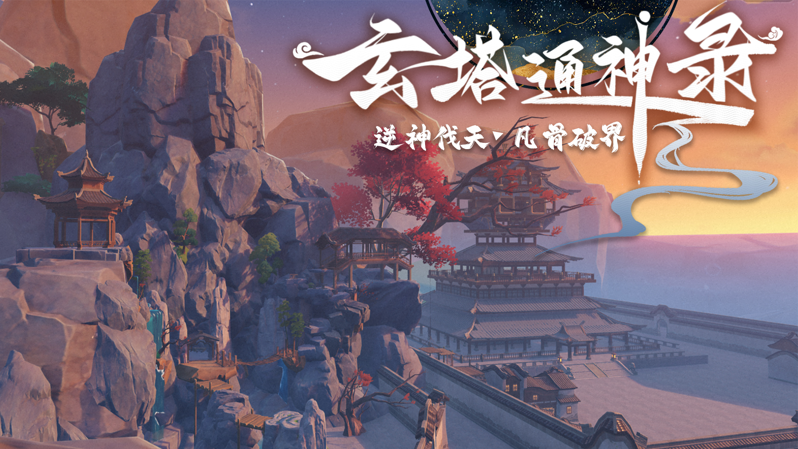
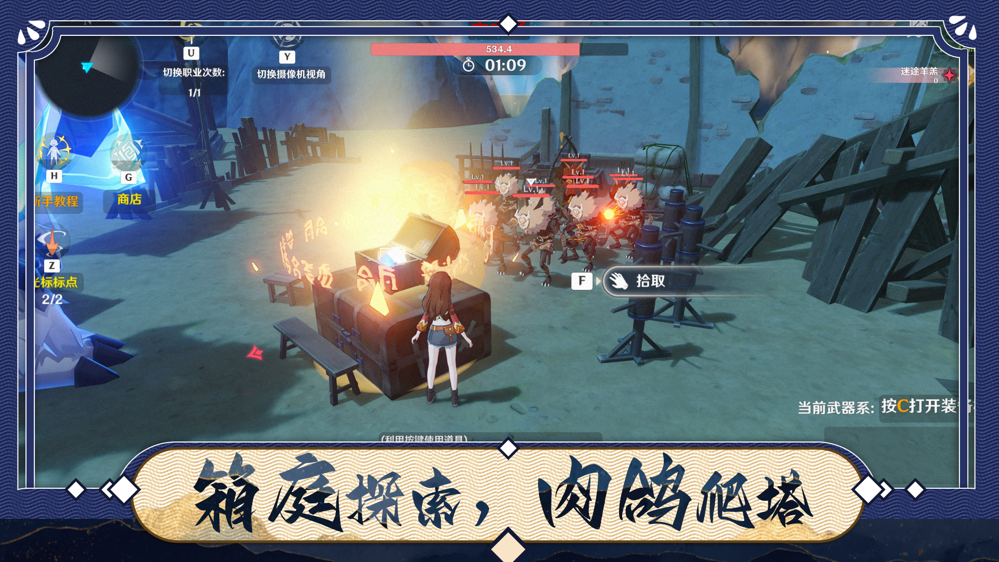
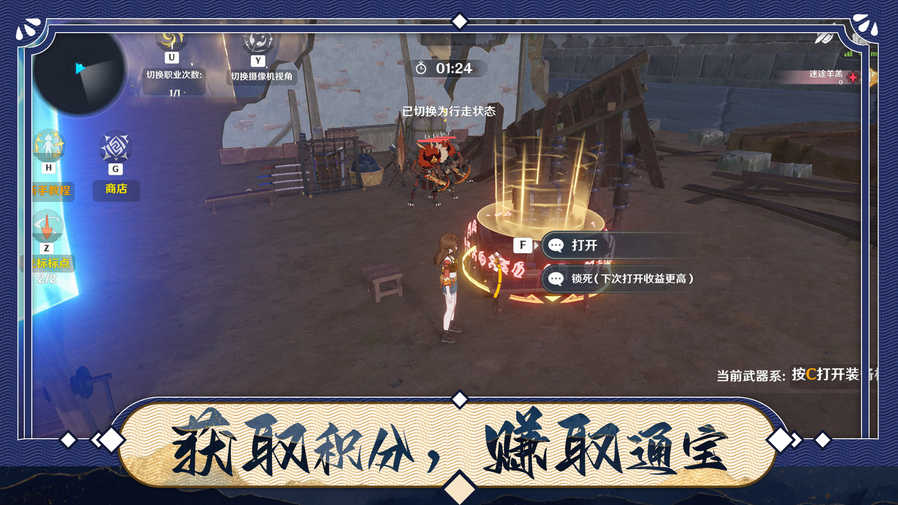
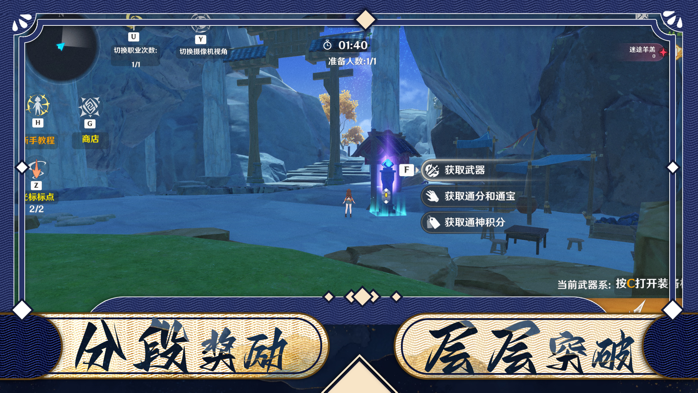
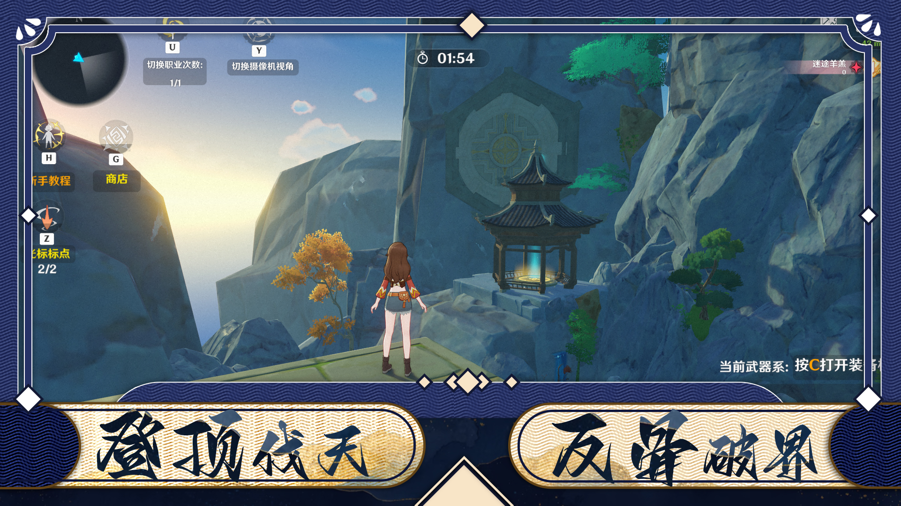
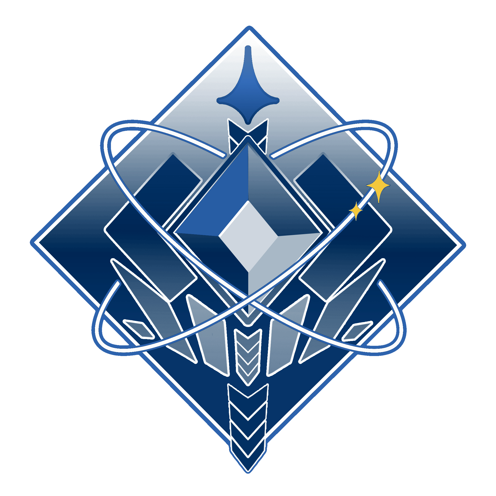

# 玄塔通神录

> **逆神伐天 · 凡骨破界**

<p align="center">
  
</p>

原神 UGC（千星奇域）关卡的工程文件存档，包含从早期原型到成品的完整迭代版本。

---

## 关卡简介

《玄塔通神录》是一座层层向上的**箱庭式爬塔关卡**。玩家自底层起步，在箱庭场景中探索、拾取、战斗，
赚取「通宝」与「通神积分」，逐层突破分段奖励，最终登顶伐天、以凡骨之躯破界。

<p align="center">
  
</p>

## 如何载入存档

仓库中的 `.gil` 是**千星奇域的存档文件**，导入后即可在游戏内载入游玩。
以下步骤依据《原神》官方教程 **「1.4 存档导入与导出」** 整理。

### ① 进入存档界面

存档页面有两种打开方式，按你当前的场景选择：

| 场景 | 操作路径 |
| --- | --- |
| **未打开编辑器 / 千星沙箱**（普通玩家从游戏进入） | 启动原神 PC 客户端并进入游戏 → 点击左上角**派蒙菜单** → **【我的奇域】** → 打开存档界面 |
| **已打开局内编辑器** | 局内编辑器左上角（或直接按 `ESC`）→ 呼出左侧面板 / ESC 菜单栏 → 点击**最左侧第二个图标** |

### ② 导入 .gil 存档

在存档页面中，点击**右下角【导入存档】** → 选择本仓库中需要导入的 `.gil` 文件 → 完成导入。

### ③ 载入游玩

导入完成后，存档会出现在存档列表中，选中并载入即可进入《玄塔通神录》。

> **建议从 `Final_build.gil` 或 `12.3.gil` 开始**（定版，体验完整）。
> 若想对比迭代过程，可按日期选择更早期的版本，越靠前的版本内容越接近原型。

### 存档管理

| 功能 | 说明 |
| --- | --- |
| **新建页签** | 创建一个新的存档文件夹，用于存档分区管理 |
| **重命名** | 修改存档名称，用于区分和记忆（**仅对自己生效**；导入已重命名过的存档会以默认格式命名） |
| **导出存档** | 选中存档 → 鼠标悬停后点击**左下角** → 选择【导出存档】→ 选择保存路径 |

> 💡 **小坑**：导出时若在保存路径页面点击【保存】没有反应，是因为**没有给导出文件命名** ——
> 先填好文件名，保存按钮才能被按下。（官方 FAQ 明确说明）

### 注意事项

- ⚠️ **建议导入到新建存档中**，避免覆盖你已有的存档。导入前请先备份当前存档。
- 本仓库中的 `.gil` 制作于 **2025 年 10 月至 12 月**。若你的游戏版本与之差异较大，
  导入后的表现可能与下方截图不完全一致；跨版本导入也可能失败。
- 官方提示：若资源之间存在关联内容，导入 / 导出时需将关联内容一并处理，
  否则会丢失部分资源之间的引用信息。
- 官方提示：关卡试玩或上传时来回切换窗口离开 / 返回编辑器，有概率导致编辑器未响应，
  耐心等待恢复即可。

## 玩法特色

### 一、箱庭探索，肉鸽爬塔

开箱拾取、随机成长，每局构筑都不重复。场景中散落可交互宝箱与道具，
按 `F` 拾取，按 `Z` 使用光标标点定位关键物品。

<p align="center">
  
</p>

### 二、获取积分，赚取通宝

核心资源循环：通关与战斗产出积分，积分兑换通宝。宝箱可选择**立即打开**，
或**锁死**——本次不开、下次打开收益更高，形成风险与收益的取舍。

<p align="center">
  
</p>

### 三、分段奖励，层层突破

每突破一个分段，可在奖励节点一次领取三类成长资源：

| 奖励类型 | 说明 |
| --- | --- |
| 获取武器 | 补充当前武器系，按 `C` 打开装备界面 |
| 获取通分和通宝 | 关卡货币，用于商店消费 |
| 获取通神积分 | 通神积分，冲击更高评价 |

<p align="center">
  
</p>

### 四、登顶伐天，反骨破界

登顶即为终局挑战 —— 逆神而伐天，以凡骨破界。

<p align="center">
  
</p>

## 操作说明

| 按键 | 功能 |
| --- | --- |
| `F` | 拾取 / 交互（打开、锁死） |
| `C` | 打开装备界面（当前武器系） |
| `H` | 新手教程 |
| `G` | 商店 |
| `U` | 切换职业（次数 1/1） |
| `Y` | 切换摄像机视角 |
| `Z` | 光标标点（2/2） |

## 成就

<p align="center">
  
</p>

<p align="center"><b>极致成就徽记</b></p>

## 目录结构

```
.
├── images/          # 封面、玩法截图、加载背景、成就徽记
├── *.gil            # 关卡存档文件（按日期迭代，早期原型 → 成品）
└── 图.zip           # 原始图片素材包
```

`.gil` 文件按 `月.日` 命名，记录了关卡从早期原型到最终成品的完整迭代过程：

| 阶段 | 代表文件 | 说明 |
| --- | --- | --- |
| 原型期 | `10.16` ~ `10.31` | 场景搭建与基础玩法验证 |
| 成长期 | `11.1` ~ `11.17` | 系统接入、数值调整 |
| 成熟期 | `11.18` ~ `11.27` | 玩法完善、表现优化 |
| 完成期 | `Final_build.gil` / `12.3.gil` | 打包定版 |

## 文件格式

| 扩展名 | 说明 |
| --- | --- |
| `.gil` | 千星奇域**存档**文件，在游戏内经【我的奇域】→【导入存档】载入 |
| `.gia` | 千星奇域**资产 / 节点图**文件，在局内编辑器的「资产导入导出管理」中加载使用 |

> 本仓库目前只收录了 `.gil` 存档文件与展示用图片，不含 `.gia` 资产文件。

## 素材说明

`images/` 中的图片同时是关卡在奇域展示页使用的视觉素材：

| 图片 | 用途 |
| --- | --- |
| `cover.jpg` | 关卡封面 |
| `loading-bg.jpg` | 加载背景（水墨楼阁） |
| `achievement-emblem.jpg` | 极致成就徽记 |
| `01` ~ `04` | 玩法介绍截图（对应上述四大特色） |

## 说明

- 本仓库为个人关卡创作的版本存档，用于记录迭代过程与作品展示。
- 关卡内容使用《原神》千星奇域 UGC 编辑器制作，游戏素材版权归米哈游（miHoYo）所有。
- 本仓库与米哈游无官方关联。

## 参考资料

- [《原神》千星奇域官方教程 — 1.4 存档导入与导出](https://act.mihoyo.com/ys/ugc/tutorial/course/detail/mhjuwpiubrh0)
- [《原神》千星奇域官方教程 — 1.6 奇域资产中心](https://act.mihoyo.com/ys/ugc/tutorial/course/detail/mhgf8i0hvzag)
